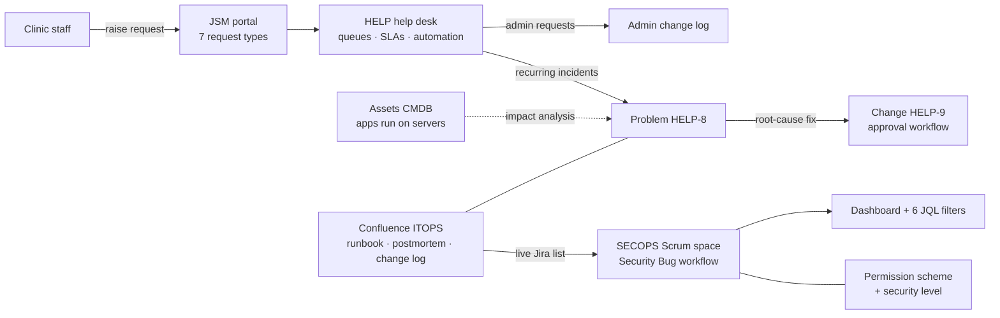

# Atlassian Cloud Admin Lab

**Jira · Jira Service Management · Assets · Confluence** | Built by Kabir Athwal · Atlassian Rovo Fundamentals (2026)

I administered the Atlassian Cloud site of a fictional 40-person healthcare clinic, from a Scrum space and JQL reporting to custom workflows, role-based permissions, work-item security, an ITSM help desk with incident, problem and change, and an Assets CMDB. Every configuration change is logged with a reason, a rollback and a test, and checked against Jira's audit log.

> **Scenario:** Kestrel Valley Health Clinic is fictional. All people, tickets and data are made up. Built on an Atlassian Cloud Premium trial, October 2026.

## At a glance

| | |
|---|---|
| Work items | 24 imported (10 stories, 9 tasks, 5 bugs) in 5 epics, plus 9 help desk tickets |
| Saved JQL filters | 6, feeding 1 shared dashboard |
| Custom workflows | 2 (Security Bug, Change), with conditions, a validator and post-functions |
| Space roles | 3 custom (Security Lead, Member, Viewer) in a least-privilege permission scheme |
| Request types | 7 in 3 portal groups, with priority-based SLAs on two calendars |
| Assets objects | 4 across 2 object types, linked by dependency references |
| Admin changes logged | 41, each with reason, rollback and test result |
| Tests passed | 12 (see [How I verified it](#how-i-verified-it)) |

## What's configured

| Area | What I built | Evidence |
|---|---|---|
| **Jira work management** | Company-managed Scrum space `SECOPS`: 24 items imported from CSV, 5 epics, components with default assignees, a sprint, 6 saved filters, the SecOps Overview dashboard | [Board](docs/screenshots/1-jira-work-management/01-sprint-board.png) · [Epics](docs/screenshots/1-jira-work-management/02-backlog-epics.png) · [Dashboard](docs/screenshots/1-jira-work-management/03-dashboard.png) · [Filters](docs/screenshots/1-jira-work-management/04-saved-filters.png) |
| **Workflow and fields** | Required **Severity** field (Bug only, via its own field scheme). **KV SECOPS Security Bug workflow**: Triage validator requires Severity, Start work auto-assigns, Approve limited to the Security Lead role and sets Resolution | [Workflow](docs/screenshots/2-workflow-and-fields/05-security-bug-workflow.png) · [Validator blocking](docs/screenshots/2-workflow-and-fields/06-validator-blocks-triage.png) |
| **Access control** | **KV SECOPS Permission Scheme** with "Any logged in user" removed everywhere; roles Security Lead, Member, Viewer; security level **Security team only** hiding the chat-api secrets bug; tested with a second user | [Permission helper](docs/screenshots/3-access-control/07-permission-helper.png) · [Hidden level](docs/screenshots/3-access-control/08-test-user-cannot-see-level.png) · [Scheme](docs/screenshots/3-access-control/09-permission-scheme-roles.png) |
| **ITSM help desk** | JSM space `HELP`: 7 request types (including an **Atlassian admin request** for config changes), SLAs on 24/7 and business-hours calendars, 2 queues, phishing-triage automation, 5 portal tickets worked | [SLA](docs/screenshots/4-service-desk/10-sla-time-to-resolution.png) · [Queue](docs/screenshots/4-service-desk/11-help-unassigned-queue.png) · [Reply vs note](docs/screenshots/4-service-desk/12-ticket-public-reply-internal-note.png) · [Automation](docs/screenshots/4-service-desk/13-automation-audit-log.png) · [Portal](docs/screenshots/4-service-desk/14-portal-home.png) · [Admin request](docs/screenshots/4-service-desk/18-admin-request-help-7.png) |
| **Problem and change** | Problem HELP-8 linking two VPN incidents; normal change HELP-9 (risk, backout plan, window) through the **KV HELP Change workflow**, approved by a second user | [Approve hidden from non-approver](docs/screenshots/5-problem-and-change/19-approve-hidden-for-non-approver.png) · [History](docs/screenshots/5-problem-and-change/20-change-history-approved-by-test-user.png) · [Problem links](docs/screenshots/5-problem-and-change/21-problem-linked-incidents-change.png) · [Workflow](docs/screenshots/5-problem-and-change/22-kv-help-change-workflow.png) |
| **Assets (CMDB)** | Schema **KVIT** with Server and Application object types; a **Runs on** reference (Dependency) so each app points to the server it depends on | [VPN Gateway dependency](docs/screenshots/6-assets-cmdb/23-assets-vpn-gateway-dependency.png) |
| **Documentation** | Confluence space **ITOPS**: VPN runbook with a live Jira list, postmortem linked from the problem ticket, and the admin change log, matched against Jira's audit log | [Runbook](docs/screenshots/7-confluence-and-audit/24-confluence-vpn-runbook.png) · [Change log](docs/screenshots/7-confluence-and-audit/25-confluence-admin-change-log.png) · [Audit log](docs/screenshots/7-confluence-and-audit/26-jira-audit-log.png) |

## How it fits together



## Design decisions

- **Permissions go to roles, not people.** One scheme can serve many spaces, and each space decides who fills each role, so access follows the job. "Any logged in user" was removed from every permission.
- **Copies, not edits, of shared defaults.** The SECOPS field scheme and permission scheme are copies of the defaults, so changing them can't affect any other space.
- **Severity is required at Triage, not at create.** Reporters are never blocked from filing a bug; the security team must rate it before work starts.
- **A security level instead of a separate space.** The secrets bug stays in the same board and reports for the security team, but doesn't exist for anyone else, including in search.
- **Two SLA calendars.** Highest priority runs 24/7; everything else runs on business hours, so the SLA reflects when staff can actually respond.
- **Config changes go through the help desk.** Staff request Jira changes with the Atlassian admin request type, and each one lands in the change log with a rollback (e.g. the Vendor field from HELP-7).
- **Consistent naming.** Every scheme, workflow, filter and queue starts with `KV` and the space it serves, so nobody edits a shared scheme by accident.

## How I verified it

| # | Test | Expected | Result |
|---|---|---|---|
| 1 | Move a bug to Triage with no Severity | Validator blocks it | ✅ Blocked (SECOPS-13) |
| 2 | Run a bug through the full workflow | Start work auto-assigns; Approve sets Resolution = Done | ✅ |
| 3 | Test user as Member opens a bug in review | Sees Submit, no Approve | ✅ |
| 4 | Permission helper: can the Viewer edit? | Denied: not in Administrators, Security Lead or Member | ✅ |
| 5 | Test user searches `level = "Security team only"` | Level doesn't exist for them | ✅ Error: value does not exist |
| 6 | Medium ticket logged Monday after 5 pm | First response due Tue 5 pm, resolution Thu 5 pm | ✅ |
| 7 | Five portal tickets, one of them phishing | Automation acts on the phishing ticket only | ✅ 1 success, 4 skipped |
| 8 | Security reports queue | Shows only the phishing ticket | ✅ |
| 9 | Admin request HELP-7 | Vendor field added to the VPN form and logged | ✅ |
| 10 | I open a change assigned to the test user | I see Declined, not Approved | ✅ |
| 11 | Test user approves HELP-9 | Change moves to In Progress; history shows the test user | ✅ |
| 12 | Runbook's Jira macro | Lists live SECOPS and HELP tickets | ✅ 8 items |

## Admin change log

All 41 changes, plus the permission matrix: **[docs/admin-change-log.md](docs/admin-change-log.md)**. The same log is a Confluence page in ITOPS, and the audit log screenshot shows the matching entries.

Problems I hit and how I handled them (each is in the log):
- **Resolution not set on Done:** reports showed 0 resolved. Added a post-function setting Resolution; documented that reopened items keep it.
- **Help desk template had no Problem or Change types:** created both and built the change workflow from scratch.
- **New workflow stayed inactive:** the workflow scheme was still a draft. Published it and migrated the existing ticket's statuses.
- **Test user couldn't be assigned:** found with the permission helper that the customer account had been added to the agent team by mistake. Fixed the roles.

## Repo contents

```
README.md
docs/admin-change-log.md      every change: reason, rollback, test; permission matrix
docs/screenshots/             26 screenshots in 7 folders, numbered in build order
jira/secops_work_items.csv    the 24 work items imported into SECOPS
jira/jql_filters.md           the 6 saved filters and other JQL used
jsm/help_desk_config.md       request types, SLAs, queues, automation, change workflow
```
